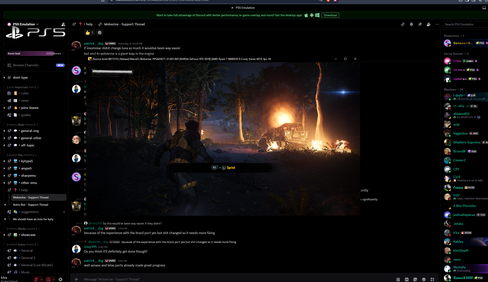

<div align="center">

# KytyPS5 · Wolverine

**Um fork experimental para estudar e melhorar Marvel’s Wolverine no PC.**


[**Baixar builds**](https://github.com/calang000/KytyPS5-Wolverine/releases) · [Relatar problema](https://github.com/calang000/KytyPS5-Wolverine/issues) · [Como compilar](#compilar) · [Créditos](#créditos)

</div>

> [!WARNING]
> **EXPERIMENTAL.** O jogo abre e chega à partida, mas o desempenho ainda varia,
> há falhas gráficas e podem ocorrer crashes. **30 FPS estáveis ainda não foram
> alcançados.** Esta é uma versão independente de pesquisa, não uma release
> oficial do projeto KytyPS5 upstream, da Sony, da Insomniac ou da Marvel.

## Uma imagem do projeto



*Captura fornecida por calang000, de 28/10/2026, mostrando uma build anterior
(`8877274`). É uma ilustração do jogo em execução; não é um benchmark nem uma
promessa de desempenho da release atual.*

## Sobre este fork

Este fork foi **vibe codado por calang000 com assistência de IA/Codex**: estudo,
implementação e testes feitos com ajuda de IA sobre o trabalho dos projetos
originais. Isso não substitui revisão e validação; bugs e regressões continuam
possíveis. O objetivo é avançar com medições reproduzíveis e publicar candidatas
que outras pessoas possam testar, sem anunciar ganhos que não foram demonstrados.

A base é o [fork Wolverine do IDXTRI](https://github.com/IDXTRI/KytyPS5), derivado
[do KytyPS5](https://github.com/KytyPS5/KytyPS5). O foco atual é o jogo
**PPSA03671, versão 01.001.005**, no Windows x64.

### O que está na candidata

- Preparo de recursos de shaders com leituras agrupadas e reutilização validada.
- Backend task/mesh para reduzir determinadas leituras síncronas da GPU pela CPU.
- Agrupamento conservador de escritas da CPU em páginas de 64 KiB, sem descartar
  dados que ainda pertencem à GPU.
- Perfil de execução separado, caches persistentes e logs por sessão.
- Experimentos que não mostraram ganho relevante não são ativados pelo launcher.

### Desempenho: o que realmente foi medido

Em uma comparação local, na mesma cena e câmera, o agrupamento de páginas ficou
em aproximadamente **18,6–19,1 FPS**, contra **17,5–18,4 FPS** no controle
(task backend ligado em ambos), uma diferença local de cerca de **4–6%**.
A candidata passou em um teste curto de movimento de 60 segundos.

Esse resultado é limitado a uma cena, em um Ryzen 7 9800X3D, RTX 5070 e 32 GB de
RAM. **Não é desempenho garantido durante combate nem uma validação de campanha
completa.** Quedas severas e consumo alto de RAM/VRAM continuam sendo investigados.
Os detalhes dos métodos ficam em [research/](research/).

## Baixar e executar

Testado em **Windows 11 x64**, com driver de GPU compatível com **Vulkan 1.3**.
O executável também utiliza o [Visual C++ v14 Redistributable x64 da Microsoft](https://aka.ms/vc14/vc_redist.x64.exe).

1. Abra [Releases](https://github.com/calang000/KytyPS5-Wolverine/releases) e
   baixe o ZIP **Windows x64**. As primeiras versões são pré-releases.
2. Extraia tudo para uma pasta com permissão de escrita.
3. Execute **`Play Wolverine.bat`**.
4. Informe a pasta do seu próprio dump que contém `eboot.bin`.

O perfil fica em **`%LOCALAPPDATA%\KytyPS5-Wolverine\profiles\PPSA03671`**:

| Pasta | Conteúdo |
| --- | --- |
| `_SaveData` | Saves deste perfil |
| `_PipelineCache` | Caches locais do emulador e do driver |
| `logs` | Log separado de cada execução |
| `config` | Configuração de execução, sem alterar o dump |

O launcher não adiciona invulnerabilidade. Para migrar um save de outro perfil,
feche o emulador, faça backup das duas pastas e copie apenas os dados de save
correspondentes; não misture configurações e caches de builds incompatíveis.

**Nenhum dump, arquivo do jogo, firmware, chave ou save é fornecido.** Use seu
próprio dump. Para outros jogos, prefira o projeto KytyPS5 original.

## Shaders e travadas iniciais

O emulador já mantém caches locais de programas traduzidos e pipelines Vulkan.
Uma primeira execução ou uma área nova ainda pode exigir compilação e causar
travadas. Preservar caches compatíveis ajuda, mas não corrige sozinho os gargalos
que permanecem depois do carregamento.

Uma preparação de shaders antes de iniciar o jogo está **em avaliação**. Ainda
não existe neste fork uma etapa que pré-compile todos os shaders de toda a
campanha. Não são distribuídos caches extraídos do jogo nem caches de outro PC.
Veja a [avaliação técnica](docs/SHADER-PREPARATION.md).

## Compilar

Dependências e instruções gerais do projeto original estão no
[README de origem](docs/UPSTREAM-WOLVERINE.md). No Windows, use ferramentas C++
do Visual Studio, Clang/LLVM, CMake, Ninja e glslang, com os submódulos clonados.

```powershell
git clone --recursive https://github.com/calang000/KytyPS5-Wolverine.git
cd KytyPS5-Wolverine
cmake -S . -B _Build/windows -G Ninja -DCMAKE_BUILD_TYPE=Release -DKYTY_BUILD_LAUNCHER=OFF -DCMAKE_C_COMPILER=clang-cl -DCMAKE_CXX_COMPILER=clang-cl -DKYTY_BUILD_ORIGIN=Fork -DKYTY_BUILD_REPOSITORY=calang000/KytyPS5-Wolverine
cmake --build _Build/windows --target kyty_emulator --parallel 2
```

Execute esses comandos em um terminal com o ambiente C++ do Visual Studio
carregado. O [workflow Windows](.github/workflows/build.yml) registra o processo
de compilação, testes e empacotamento usado nas publicações.

## Como as versões são publicadas

Releases públicas recebem fonte correspondente, notas de validação e checksum
SHA-256. Builds experimentais usam tags `-rc.N`; versões estáveis só serão
marcadas após validação mais ampla. Commits de pesquisa não viram releases
automaticamente. Consulte o [processo de publicação](docs/RELEASING.md).

## Créditos

O trabalho deste fork depende do esforço de muitos desenvolvedores:

- **KytyPS5 e seus contribuidores**, e **InoriRus/Kyty**, pela base do emulador.
- **IDXTRI / DXTR**, pela base Wolverine v2 usada neste projeto.
- **Mac (itsmemac), Senaxx e Ali Almohaya**, pelo trabalho de Wolverine/PR #937
  e pelas correções posteriores presentes na base.
- **Jetsku**, pelo passe de redução de arrays SPIR-V presente na base.
- Autores das bibliotecas e dos demais componentes, conforme seus avisos de licença.

O histórico e os avisos de copyright são preservados. Consulte
[LICENSE](LICENSE), [LICENSES](LICENSES) e as licenças dos submódulos.

---

**English:** Experimental, AI-assisted/vibe-coded Wolverine research fork.
Stable 30 FPS has not been achieved. The screenshot is from an older build.
Downloads contain no game files, firmware, keys, saves or extracted shader caches.
Upstream projects and contributors retain their credits and licenses.
